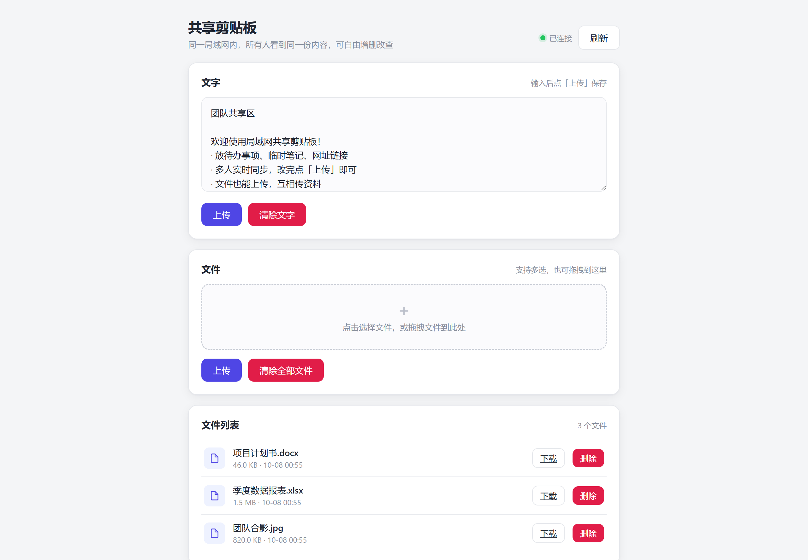
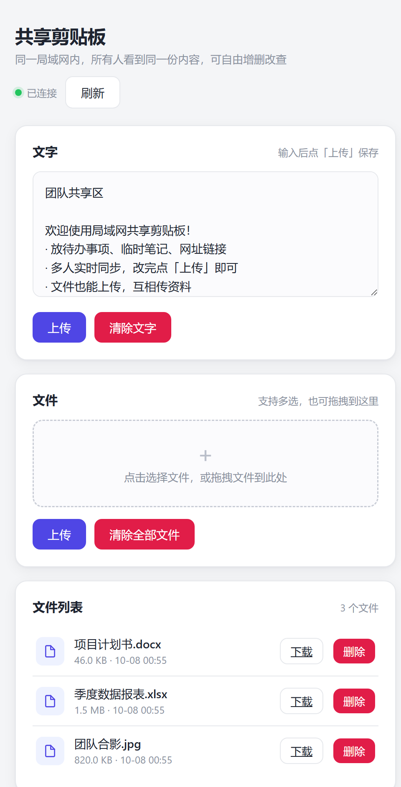

# 局域网共享剪贴板（share_server）

一个开箱即用的**局域网共享剪贴板 + 文件协作工具**。部署到任意一台机器上后，同一局域网内的所有设备（电脑、手机、平板）打开浏览器访问 `http://IP:8080/`，就能看到**完全相同**的一份内容，实时同步文字和多文件。

- **纯 Python 标准库**，零第三方依赖，不需要装任何框架、数据库、Web 服务器。
- **单文件**实现，前后端都在这一个 `share_server.py` 里。
- **跨平台**，Windows / Linux / macOS / 树莓派 / Android（Termux）都能一键跑起来。

---

## 界面预览

**桌面端**



**移动端（手机浏览器）**



---

## 目录

- [它能做什么](#它能做什么)
- [界面预览](#界面预览)
- [技术栈](#技术栈)
- [运行原理](#运行原理)
- [目录结构](#目录结构)
- [环境要求](#环境要求)
- [快速开始（3 步跑起来）](#快速开始3-步跑起来)
- [各平台详细部署教程](#各平台详细部署教程)
  - [Windows](#1-windows-部署)
  - [Linux / 树莓派](#2-linux--树莓派-部署)
  - [macOS](#3-macos-部署)
  - [Android 手机（Termux）](#4-android-手机termux部署)
- [开机自启动与后台运行](#开机自启动与后台运行)
- [常用配置说明](#常用配置说明)
- [使用说明](#使用说明)
- [HTTP 接口文档](#http-接口文档)
- [常见问题（FAQ）](#常见问题faq)
- [安全提示](#安全提示)

---

## 它能做什么

| 功能 | 说明 |
| --- | --- |
| 文字共享 | 在任一台设备上输入文字保存，其他设备自动看到 |
| 多文件上传 | 一次可多选上传多个文件，支持拖拽 |
| 文件下载 | 点击列表里的文件即可下载 |
| 文件删除 | 单个删除或一键清空，**物理删除磁盘文件** |
| 上传预览 | 选中文件后先显示待上传列表，点「上传」才真正入库，上传中按钮显示「上传中…」 |
| 实时同步 | 所有打开页面的设备约 2 秒自动刷新一次 |
| 并发安全 | 多人同时上传/删除/改文字不会互相覆盖、不会出错 |

---

## 技术栈

- **后端**：Python 3 标准库 `http.server`（`ThreadingHTTPServer` + `BaseHTTPRequestHandler`），多线程并发处理。
- **数据存储**：文字和文件索引存 `manifest.json`；文件本体按随机 ID 存 `share_data/files/` 目录。
- **并发安全**：`threading.Lock` 全局锁 + 临时文件原子替换（写 `.tmp` 再 `os.replace`）。
- **前端**：原生 HTML + CSS + 原生 JavaScript（`fetch` + `async/await`），无任何前端框架。
- **实时同步**：前端每 2 秒轮询一次 `/state` 接口拉取最新内容（未使用 WebSocket，保持零依赖）。
- **大文件**：上传/下载均为 1MB 分块流式读写，避免整体读入内存。

---

## 运行原理

```
浏览器A ─┐
浏览器B ─┤  定期轮询 /state（约2秒一次）
浏览器C ─┘        │
                  ▼
          Python HTTP 服务 (8080端口)
                  │
        ┌─────────┴──────────┐
        ▼                    ▼
   manifest.json          share_data/files/
   （文字 + 文件索引）      （文件本体，随机ID命名）
```

1. 所有人打开的都是同一个网页、同一份数据。
2. 任何一个人修改文字、上传/删除文件，数据先落盘保存。
3. 其他设备通过轮询 `/state` 发现变化，自动刷新页面显示。

---

## 目录结构

```
项目根目录
├── share_server.py   # 主程序（唯一需要运行的文件）
├── README.md         # 本说明文档
└── .gitignore        # git 忽略规则
```

运行时自动生成（无需手动创建）：

```
~（用户主目录）
└── share_data/
    ├── manifest.json    # 文字内容 + 文件索引
    └── files/           # 上传的文件本体
```

> 数据目录默认在你运行用户的主目录下（`os.path.expanduser('~')`），例如：
> - Windows：`C:\Users\你的用户名\share_data\`
> - Linux/macOS：`/home/你的用户名/share_data/`、`/Users/你的用户名/share_data/`
> - Android Termux：`/data/data/com.termux/files/home/share_data/`

---

## 环境要求

唯一的硬性要求：**安装 Python 3**（建议 3.8 及以上）。

- 不需要 nginx、不需要 MySQL、不需要 PHP、不需要宝塔面板。
- 不需要 `pip install` 任何东西（全部标准库）。

---

## 快速开始（3 步跑起来）

> 假设你已经在电脑上装好了 Python 3（怎么装见下方「各平台详细部署教程」）。

**第 1 步：拿到代码**

把 `share_server.py` 下载到你电脑上任意一个文件夹（比如 `D:\share` 或 `~/share`）。

**第 2 步：启动服务**

在终端（Windows 用「命令提示符 / PowerShell」，Linux/macOS 用「终端」）里，进入文件所在目录后执行：

```bash
python3 share_server.py
```

> Windows 上如果 `python3` 不识别，就换成 `python share_server.py`。

看到类似输出就说明启动成功了：

```
ShareServer 已启动：http://0.0.0.0:8080
```

**第 3 步：用浏览器访问**

- 本机访问：`http://127.0.0.1:8080/`
- 其他设备访问：`http://你的电脑IP:8080/`（如何查 IP 见下文）

同一局域网内的手机、平板、别的电脑，打开这个地址，看到的内容完全一致。

---

## 各平台详细部署教程

### 1. Windows 部署

**① 安装 Python**

1. 打开 Python 官网下载页：`https://www.python.org/downloads/`
2. 点击黄色的 **Download Python 3.x.x** 按钮下载安装包。
3. 双击运行安装程序，**务必勾选最下方的 `Add Python to PATH`**（把 Python 加入环境变量，很关键）。
4. 点击 **Install Now**，等待安装完成。

**② 验证安装**

按 `Win + R`，输入 `cmd` 回车，打开命令提示符，输入：

```bat
python --version
```

能显示 `Python 3.x.x` 就说明装好了。

**③ 准备文件**

把 `share_server.py` 放到一个固定文件夹，例如 `D:\share\`。

**④ 启动**

在命令提示符里执行：

```bat
D:
cd D:\share
python share_server.py
```

**⑤ 查本机 IP**

在同一个命令提示符里执行：

```bat
ipconfig
```

找到「无线局域网适配器 WLAN」或「以太网适配器」下面的 **IPv4 地址**，形如 `192.168.x.x`，就是你要给其他设备访问的 IP。

**⑥ 放行防火墙（关键，否则别人连不上）**

1. 打开「控制面板 → Windows Defender 防火墙 → 高级设置」。
2. 左侧点「入站规则」→ 右侧「新建规则」。
3. 规则类型选「端口」→ 下一步。
4. 选「TCP」、特定本地端口填 `8080` → 下一步。
5. 选「允许连接」→ 一路下一步，起个名字（如 `share`）保存即可。

完成后，其他设备用 `http://你的IP:8080/` 即可访问。

---

### 2. Linux / 树莓派 部署

以常见的 Debian / Ubuntu / 树莓派（Raspberry Pi OS）为例。

**① 安装 Python（通常已自带）**

```bash
# 检查是否已安装
python3 --version

# 如果没有，安装
sudo apt update
sudo apt install -y python3
```

**② 上传文件**

把 `share_server.py` 上传到服务器，例如放到 `~/share/` 目录：

```bash
mkdir -p ~/share
# 把文件放进去（可用 scp、ftp 等方式，这里假设文件已在该目录）
```

**③ 启动**

```bash
cd ~/share
python3 share_server.py
```

**④ 查 IP**

```bash
hostname -I
# 或者
ip addr
```

找到形如 `192.168.x.x` 的地址，其他设备用 `http://192.168.x.x:8080/` 访问。

**⑤ 放行端口（如有防火墙）**

```bash
# ufw 防火墙（Ubuntu 常用）
sudo ufw allow 8080/tcp
```

> 树莓派和普通 Linux 步骤完全一样。

---

### 3. macOS 部署

**① 安装 Python**

macOS 一般已自带 `python3`。终端里执行：

```bash
python3 --version
```

如果没有，可用 Homebrew 安装：`brew install python3`。

**② 准备文件**

把 `share_server.py` 放到一个目录，例如 `~/share/`。

**③ 启动**

打开「终端」，执行：

```bash
cd ~/share
python3 share_server.py
```

**④ 查 IP**

```bash
ipconfig getifaddr en0      # 无线网卡的 IP
# 或
ifconfig | grep "inet "
```

其他设备用 `http://你的IP:8080/` 访问。

**⑤ 防火墙**

若系统提示是否允许 Python 接受入站连接，选择「允许」。

---

### 4. Android 手机（Termux）部署

把手机变成一个局域网共享服务器。用 [Termux](https://termux.com/)（Android 终端模拟器）。

**① 安装 Termux**

1. 前往 F-Droid 应用市场搜索 `Termux` 安装（建议从 F-Droid 安装，版本较新）。
2. 打开 Termux。

**② 安装 Python 与常用工具**

在 Termux 里执行：

```bash
pkg update && pkg upgrade -y
pkg install -y python openssh
```

**③ 写入代码**

用 Termux 里的文件编辑器（如 `nano`）创建 `share_server.py`，把代码粘贴进去：

```bash
nano share_server.py
```

粘贴后按 `Ctrl + O` 回车保存，`Ctrl + X` 退出。

**④ 启动**

```bash
python3 share_server.py
```

**⑤ 查 IP**

```bash
ip addr show wlan0
```

找到 `inet` 后面的 `192.168.x.x`，其他设备用 `http://192.168.x.x:8080/` 访问。

**⑥ 可选：开启 SSH 方便电脑远程管理**

```bash
# 设置 SSH 密码（首次需要）
passwd
# 启动 sshd（监听 8022 端口）
sshd
```

之后电脑上可用 `ssh -p 8022 你的用户名@手机IP` 远程登录管理。

> 注意：AndAndroid 手机在息屏/杀后台后会杀掉 Termux 进程，需要通过下述「开机自启动」里的方式让服务常驻（如 Termux:Boot 或 `.bashrc` 自动拉起）。

---

## 开机自启动与后台运行

### Windows：任务计划程序（开机自启）

1. 按 `Win + R`，输入 `taskschd.msc` 回车打开「任务计划程序」。
2. 右侧「创建基本任务」。
3. 名称填 `share`，触发器选「当计算机启动时」。
4. 操作选「启动程序」：
   - 程序/脚本：`C:\路径\python.exe`（在命令提示符里用 `where python` 查路径）
   - 添加参数：`C:\路径\share_server.py`
   - 起始于：`C:\路径\`（脚本所在目录）
5. 完成。以后开机自动运行。

或者临时后台运行不太合适，可直接把启动命令写进一个 `.bat` 文件，放入「启动」文件夹（`Win + R` 输入 `shell:startup` 回车）。

### Linux / macOS：systemd 服务（开机自启）

创建服务文件：

```bash
sudo nano /etc/systemd/system/share.service
```

写入以下内容（把 `/home/你的用户名/share/share_server.py` 换成你的实际路径）：

```ini
[Unit]
Description=LAN Share Board
After=network.target

[Service]
Type=simple
User=你的用户名
ExecStart=/usr/bin/python3 /home/你的用户名/share/share_server.py
Restart=always
RestartSec=5

[Install]
WantedBy=multi-user.target
```

启用并启动：

```bash
sudo systemctl daemon-reload
sudo systemctl enable share
sudo systemctl start share
# 查看状态
sudo systemctl status share
```

### 后台运行（不关终端窗口的临时方式）

- Linux/macOS：

```bash
nohup python3 share_server.py > /dev/null 2>&1 &
```

- Windows：直接在任务计划程序里跑即可，或双击 `.bat`。

### Android Termux：Boot 自启

1. 从 F-Droid 安装配套应用 `Termux:Boot`。
2. 创建目录并写启动脚本：

```bash
mkdir -p ~/.termux/boot
nano ~/.termux/boot/start-share.sh
```

写入：

```bash
#!/data/data/com.termux/files/usr/bin/sh
cd ~
exec python3 share_server.py
```

3. 给执行权限：

```bash
chmod +x ~/.termux/boot/start-share.sh
```

以后手机开机启动 Termux:Boot 时，服务会自动拉起。

---

## 常用配置说明

打开 `share_server.py`，文件顶部的几个变量可以按需修改：

| 变量 | 默认值 | 说明 |
| --- | --- | --- |
| `PORT` | `8080` | 服务监听端口 |
| `MAX_TEXT` | `200 * 1024 * 1024` | 单次文字上传上限（200MB） |
| `MAX_FILE` | `200 * 1024 * 1024` | 单个文件上传上限（200MB） |
| `CHUNK` | `1024 * 1024` | 分块读写大小（1MB，一般无需动） |
| `HOME` | `os.path.expanduser('~')` | 数据存储的根目录，默认用户主目录 |

> 改完记得重启服务。想改单个文件上限，把 `MAX_FILE` 改成例如 `10 * 1024 * 1024 * 1024` 就是 10GB（需保证手机/电脑有足够内存与磁盘空间）。

---

## 使用说明

打开 `http://IP:8080/` 后，页面分成三块：

1. **文字**：在文本框里输入内容，点「保存」。所有打开页面的人约 2 秒内看到新内容。
2. **文件**：
   - 点虚线框选择文件（可多选、可拖拽）。
   - 选中后文件会先显示在下方「待上传文件」列表里（含文件名和大小），此时还没真正上传。
   - 点「上传」按钮，按钮变「上传中…」，上传完成后待上传列表清空、文件出现在正式文件列表。
   - 点「清除选中」可放弃已选但未上传的文件。
3. **文件列表**：每个文件可单独「下载」或「删除」；删除是物理删除磁盘上的文件，不可恢复。

---

## HTTP 接口文档

| 方法 | 路径 | 参数 | 说明 |
| --- | --- | --- | --- |
| `GET` | `/` | — | 返回前端页面 | 
| `GET` | `/state` | — | 返回当前全部内容（文字 + 文件列表）JSON |
| `POST` | `/text` | body=文字 | 保存文字 |
| `POST` | `/upload?name=文件名` | body=文件内容 | 上传文件 |
| `GET` | `/file/<id>` | — | 下载指定文件 |
| `POST` | `/delete/<id>` | — | 删除指定文件 |
| `POST` | `/clear_files` | — | 清空全部文件 |

---

## 常见问题（FAQ）

**Q1：别的设备打不开 `http://我的IP:8080/`？**

逐项排查：
1. 确认服务还在运行（运行窗口没关）。
2. 确认访问设备和你**在同一个局域网**（连着同一个路由器/WiFi）。
3. Windows 确认已按上文放行防火墙 8080 端口。
4. 确认 IP 填的是**运行服务那台机器**的 IP，而不是你自己的。

**Q2：端口 8080 被占用怎么办？**

改 `share_server.py` 里的 `PORT = 8080` 为别的端口（如 `8081`），重启后再用 `http://IP:8081/` 访问。

**Q3：能绑定 80 端口吗？**

Linux/macOS 上绑定 80 等 1024 以下端口需要 root 权限（`sudo python3 share_server.py`）。建议直接用 8080，访问时带上端口即可。

**Q4：文件存在哪里？上传的文件占手机/电脑空间吗？**

存在运行用户主目录下的 `share_data/files/`，会真实占用磁盘空间。删除操作会物理删除文件释放空间。

**Q5：能支持分文件夹上传吗？**

当前版本为平铺文件列表，暂未内置文件夹树。可直接改 `MAX_FILE` 提升单文件上限。文件夹结构需求可在此基础上扩展（上传用 `webkitdirectory` 选文件夹、下载用 `zipfile` 打包）。

**Q6：多个人同时用会乱吗？**

不会。后端有全局锁保证数据一致性，前端每 2 秒轮询同步，多人同时上传/删除/改文字都安全。

---

## 安全提示

- 本服务**没有任何账号密码**，内网任何能访问到该 IP 和端口的人都能增删内容，请只在**可信局域网**内使用，勿直接暴露到公网。
- 上传的文件名经过处理，但请勿在不受信任的网络放开此服务。
- 建议用防火墙仅对内网网段开放 8080 端口。

---

## License

MIT License — 随便用、随便改，保留版权声明即可。